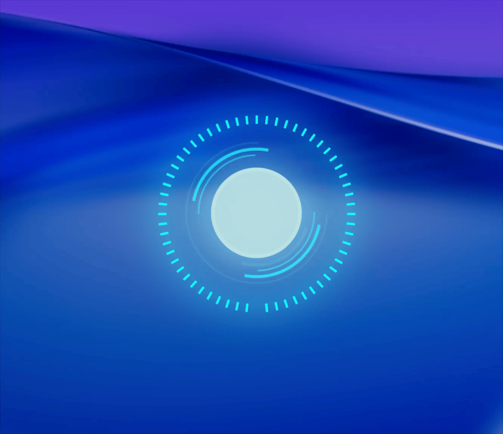

# Iron Man Arc Reactor 2 - Übersicht Widget

> Display an animated [Iron Man](https://en.wikipedia.org/wiki/Iron_Man) Arc Reactor on your macOS desktop using [Übersicht](https://tracesof.net/uebersicht/).



---

## Features

- Animated Arc Reactor rendered entirely with CSS
- Rotating concentric rings (clockwise and counter-clockwise)
- Flickering glowing core
- 60 tick marks arranged around the outer ring
- Pure decoration — no system resources monitored

---

## Requirements

| Tool | Notes |
|------|-------|
| [Übersicht](https://tracesof.net/uebersicht/) | Desktop widget engine |

---

## Installation

**1. Install Übersicht**

Download and install from [tracesof.net/uebersicht](https://tracesof.net/uebersicht/).

**2. Clone into your Übersicht widgets folder**

```sh
git clone https://github.com/leejongyoung/ironman-reactor2-ubersicht-widget \
  ~/Library/Application\ Support/Übersicht/widgets/ironman-reactor2.widget
```

**3. Refresh Übersicht** — the Arc Reactor will appear centered on your desktop.

---

## Configuration

Edit the `style` block in `reactor.coffee` to adjust appearance:

```coffeescript
# In reactor.coffee
refreshFrequency: 6000000  # Refresh interval in ms (~100 min)
```

| Property | Default | Description |
|---|---|---|
| Color | `#02feff` | Main cyan color for rings and marks |
| Core size | `110px` | Diameter of the center core |
| Reactor size | `250px` | Overall widget diameter |

> Designed for dark desktop backgrounds.

---

## How It Works

```
reactor.coffee → CSS animations → Übersicht renders on desktop
```
